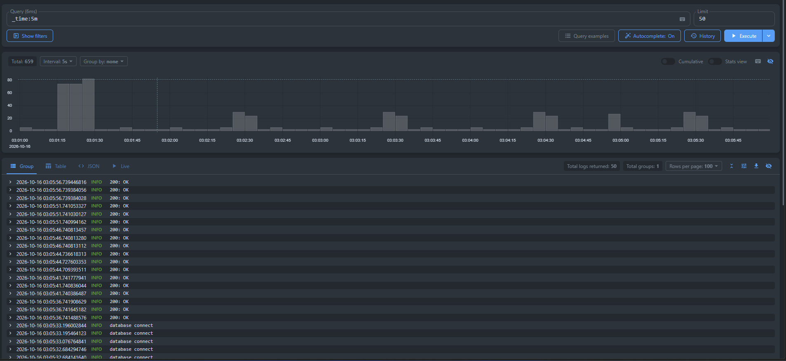
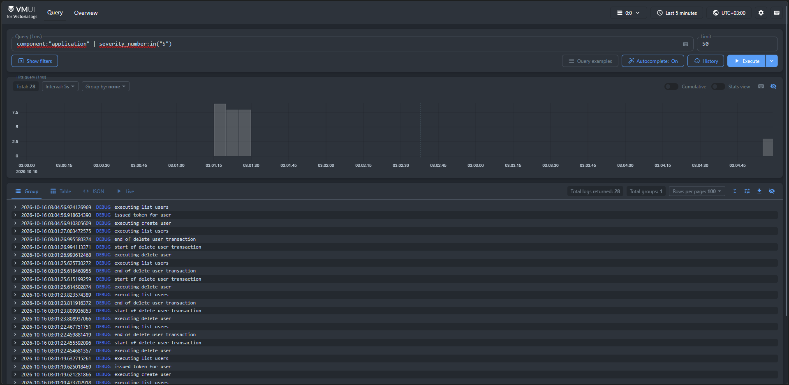
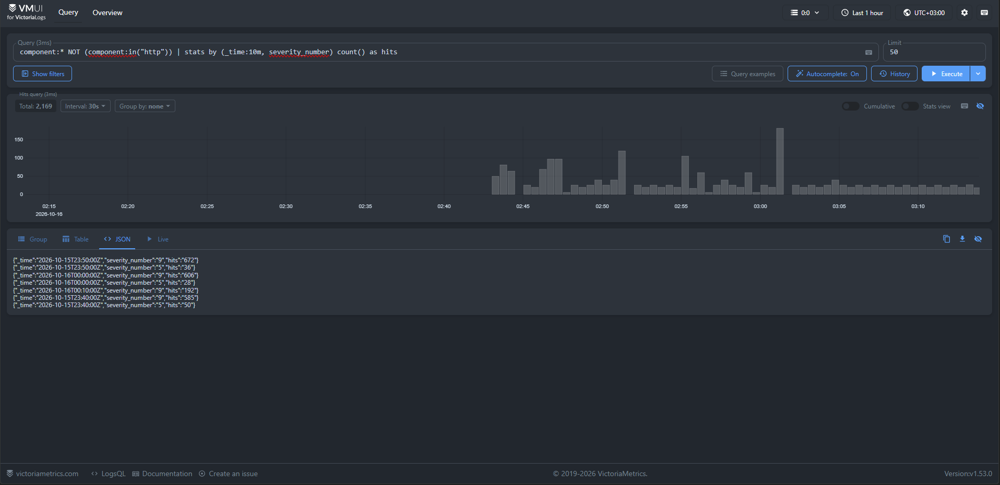
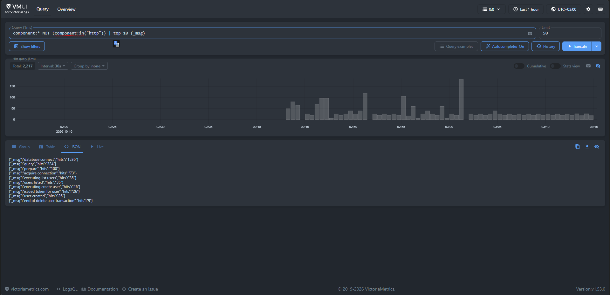

# Отчёт: Развёртывание приложения Slotify в Kubernetes (Minikube)

## 1. Описание приложения

**Slotify** — клиент-серверное веб-приложение для бронирования рабочих пространств (переговорных комнат и рабочих мест). 

Пользователи могут просматривать доступные пространства, выбирать дату и временные слоты, создавать и отменять бронирования. Администраторы управляют пространствами и пользователями. В системе используются слоты длительностью 5 минут (288 слотов в сутках), а согласованность расписания обеспечивается ограничениями СУБД.

Архитектура состоит из трёх основных компонентов:
- **Frontend** — одностраничный веб-интерфейс (SPA), раздаваемый веб-сервером Nginx.
- **Backend** — REST API сервис на Go, реализующий бизнес-логику, авторизацию и миграции.
- **Storage** — реляционная база данных для персистентного хранения пространств, пользователей и бронирований.
- **Metrics** — Различные метрики, трейсы и логи для наблюдаемости, а также grafana для их удобного просмотра

---
## 2. Скриншоты vmui для каждого из 4 запросов и коротким описанием 

### 1. Cырые записи за последние 5 минут 



Обычный запрос за последние 5 минут, в самом ui пришлось выключать автоматическое применение этого запроса для данных, так как оно игнорировало мой
А также скажу что большинство логов это запросы на доступность или самого приложения, или проверка им доступности бд


### 2. Фильтр по конкретному полю



Чтобы не было так много запросов, я начал запроса данных конкретной компоненты, а после применил фильтр по уровню логгирования

### 3. Stats-запрос с группировкой



Тут я нашёл, что во вкладке "Overview", можно достать готовые текстовые запросы, а потом применил к этому stats-запрос по количеству различных уровней логгирования за промежутки по 10 минут

### 4. Aгрегирующий запрос



Ну и наконец, решил применить агрегацию по msg чтобы узнать какое сообщение выводилось наиболее часто

---

## 3. Почему был выбран OpenTelemetry Collector

Во-первых, это де-факто стандартный способ сбора OTLP-телеметрии, очень часто вижу его в различных архитектурных примерах, в различных статьях.
Во-вторых, так как у меня сразу настроена отправка метрик и трейсов на OpenTelemetry Collector, я посчитал что добавления DaemonSet с Fluent Bit или Vector, лишь усложнит систему и добавит новую точку отказа.
В-третьих, OpenTelemetry Collector крайне гибок в настройке и мне достаточно настроить отправку всей телеметрии туда, а дальше работать лишь с настройкой конфигурации OpenTelemetry Collector.

---

## 4. Бонус: подключить официальный Grafana-плагин Victoria Logs

Успешно выполнено! А также был настроен готовый alert появляющийся сразу с запуска grafana

---

## 5. Демонстрация работы (содержание видеозаписи)

В приложенном видеоролике продемонстрированы все обязательные этапы работы с кластером Minikube

[MAIN.mkv](.github/video/MAIN.mkv) *(файл приложен к архиву)*

## 6. Запуск приложения и всего-всего

В приложение используется Taskfile, поэтому я буду приводить таски из taskfile.yaml и пояснять их

1. Запуск кластера
```yaml
k8s:start:
    desc: Start 
    vars:
      CPUS: '{{.CPUS | default "8"}}'
      MEMORY: '{{.MEMORY | default "6144"}}'
    cmds:
      - minikube start --driver=docker --cpus={{.CPUS}} --memory={{.MEMORY}}
```
- *Запускается кластер на основе движка докера с указанными cpus и memory*
- *Если хотите запукасть с иными, попробуйте `task k8s:start CPUS=4 MEMORY=1024`, но учтите что ресурсы я настраивал под default значения*

2. После этого соберите образы и добавьте их в minikube
```yaml
k8s:load:
    desc: Build images and load them into minikube
    cmds:
      - task: docker:build
      - minikube image load --overwrite=true slotify-backend:{{.BACKEND_VERSION}}
      - minikube image load --overwrite=true slotify-frontend:{{.FRONTEND_VERSION}}
```
- *`docker:build` просто собирает образы*
- *Переменные `{{.BACKEND_VERSION}}` и `{{.FRONTEND_VERSION}}` являются глобальными и содержат в себе версию текущего релиза того или иного приложения*

3. Затем скачайте Traefik (Лично мне он нравится больше других обратных прокси)
```yaml
 k8s:traefik:
    desc: Install Traefik via Helm
    cmds:
      - helm repo add traefik https://traefik.github.io/charts
      - helm repo update
      - helm upgrade --install traefik traefik/traefik -n traefik --create-namespace
```

- *Мне особо нечего добавить, кроме того, что __с helm куда лучше, чем без него__*

5. После чего нужно поднять всё окружение
```sh
task helm:metrics:apply
task helm:storage:apply
task k8s:deploy:slotify
```
- *Тут всё довольно банально, `kubectl rollout status statefulset/postgres -n slotify --timeout=120s` ожидает запуска `postgres` и выводит стутус `partitioned roll out complete`*

6. И в конце создайте тунель для спокойной работы с traefik и CORS
```yaml
k8s:tunnel:
    desc: Run minikube tunnel (keep running, may need admin rights)
    cmds:
      - minikube tunnel
```

И вот после этого всё работает

Проверка:
```sh
curl -v  http://slotify.local/api/healthz
* Host slotify.local:80 was resolved.
* IPv6: (none)
* IPv4: 127.0.0.1
*   Trying 127.0.0.1:80...
* Established connection to slotify.local (127.0.0.1 port 80) from 127.0.0.1 port 53661 
* using HTTP/1.x
> GET /api/healthz HTTP/1.1
> Host: slotify.local
> User-Agent: curl/8.21.0
> Accept: */*
> 
* Request completely sent off
< HTTP/1.1 200 OK
< Content-Length: 0
< Date: ***
< Vary: Origin
< 
* Connection #0 to host slotify.local:80 left intact
```
