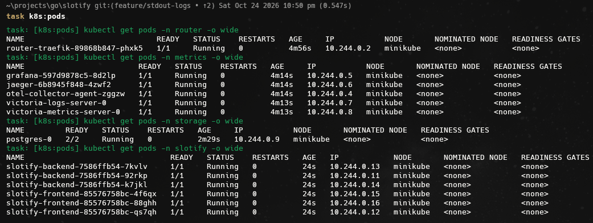
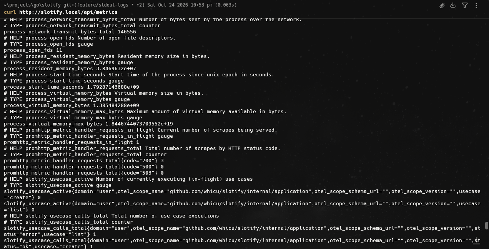
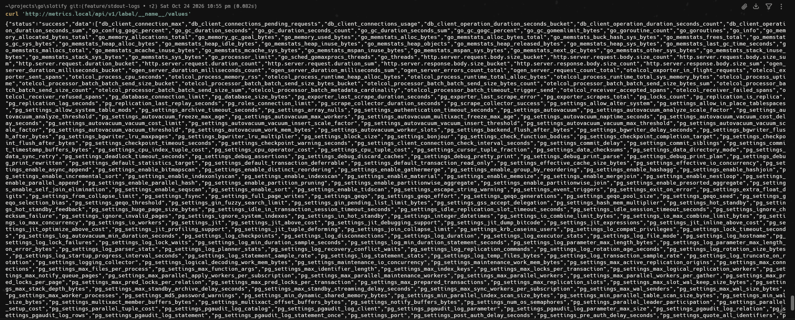
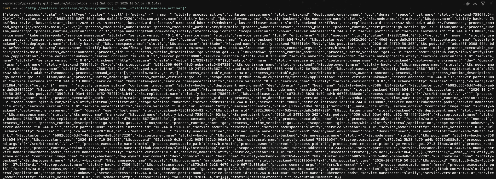
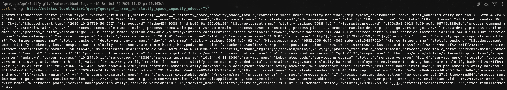
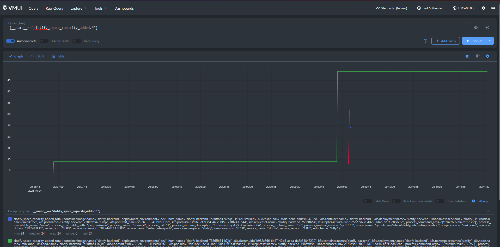

# Отчёт: Развёртывание приложения Slotify в Kubernetes (Minikube)

## 1. Описание приложения

**Slotify** — клиент-серверное веб-приложение для бронирования рабочих пространств (переговорных комнат и рабочих мест). 

Пользователи могут просматривать доступные пространства, выбирать дату и временные слоты, создавать и отменять бронирования. Администраторы управляют пространствами и пользователями. В системе используются слоты длительностью 5 минут (288 слотов в сутках), а согласованность расписания обеспечивается ограничениями СУБД.

Архитектура состоит из трёх основных компонентов:
- **Frontend** — одностраничный веб-интерфейс (SPA), раздаваемый веб-сервером Nginx.
- **Backend** — REST API сервис на Go, реализующий бизнес-логику, авторизацию и миграции.
- **Storage** — реляционная база данных для персистентного хранения пространств, пользователей и бронирований.
- **Metrics** — Различные метрики, трейсы и логи для наблюдаемости, а также grafana для их удобного просмотра

---
## 2. Архитектура мониторинга и стек технологий

 
| Компонент | Что используется | Namespace |
|---|---|---|
| TSDB | VictoriaMetrics single-node (Helm-чарт `victoria-metrics-single`) | `metrics` |
| Сборщик метрик | OpenTelemetry Collector (contrib), DaemonSet | `metrics` |
| Метрики приложения | prometheus формат на пути `slotify.local/api/metrics` | `slotify` |
| Метрики PostgreSQL | `postgres-exporter` (sidecar в поде Postgres) | `storage` |
| Метрики ingress | Traefik, встроенный экспортер Prometheus | `traefik` |

### Почему сбор идёт через OpenTelemetry Collector, а не через vmagent
 
OpenTelemetry Collector уже использовался для логов и трейсов, поэтому отдельный `vmagent` добавил бы ещё один компонент без нового функционала. Collector умеет то же, что нужно для задания: принимает OTLP (push) и содержит Prometheus receiver с service discovery Kubernetes (pull), а затем отправляет всё в VictoriaMetrics по протоколу OTLP.

## 3. Бизнес-метрики

| Метрика | Тип | Единица | Атрибуты | Что показывает |
|---|---|---|---|---|
| `slotify.usecase.calls` | Counter | `{call}` | `domain`, `usecase`, `status` (`ok`/`error`) | Число выполнений use case, в том числе успешных и неуспешных |
| `slotify.usecase.duration` | Histogram | `s` | `domain`, `usecase`, `status` | Длительность выполнения use case |
| `slotify.usecase.active` | UpDownCounter | `{call}` | `domain`, `usecase` | Сколько use case выполняется прямо сейчас |
||
| `slotify.booking.slots.booked` | Counter | `{slot}` | `CreateBooking` | Сколько слотов всего забронировано |
| `slotify.booking.slots_per_booking` | Histogram | `{slot}` | `CreateBooking` | Распределение числа слотов в одном запросе на бронирование (на сколько времени бронируют) |
| `slotify.booking.slots.cancelled` | Counter | `{slot}` | `CancelBooking` | Сколько слотов отменено |
| `slotify.booking.space_date.occupied_slots` | Histogram | `{slot}` | `ListBySpaceAndDate` | Сколько занятых слотов возвращает запрос расписания пространства на дату (загруженность) |
| `slotify.booking.user.bookings_count` | Histogram | `{booking}` | `ListByUser` | Сколько бронирований возвращается в списке пользователя |
| `slotify.space.capacity.added` | Counter | `{seat}` | `CreateSpace` | Суммарная вместимость добавленных пространств |
| `slotify.space.list.count` | Histogram | `{space}` | `ListSpaces` | Сколько пространств возвращает запрос списка |
| `slotify.user.list.count` | Histogram | `{user}` | `ListUsers` | Сколько пользователей возвращает запрос списка (доступен администратору) |

## 4. Пример работы

### Поды



### Метрики









### UI



## postgres метрики

PostgreSQL установлен Helm-чартом Bitnami. Экспорт включается одной настройкой:
 
```yaml
metrics:
    enabled: true

    service:
      annotations:
        prometheus.io/scrape: "true"
        prometheus.io/port: "9187"

    resources:
      requests:
        cpu: 50m
        memory: 64Mi
      limits:
        cpu: 150m
        memory: 128Mi
```